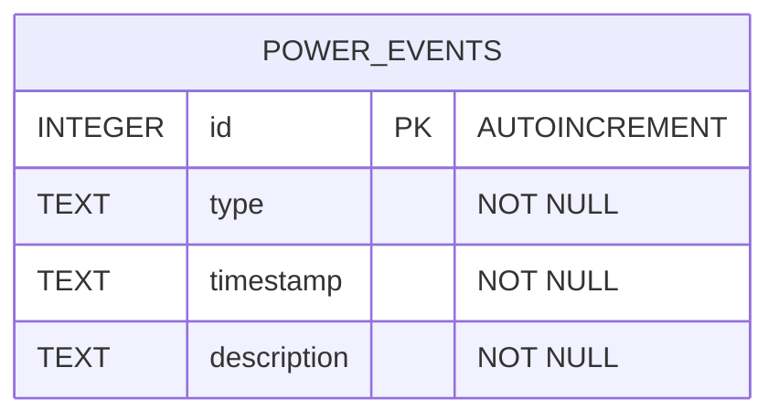

# System Monitor

A macOS desktop system-monitoring application built with **Electron, React, and Node.js**.

System Monitor provides a compact desktop interface for monitoring system resources, viewing battery information, managing monitoring preferences, and keeping track of important system power events.

The project also includes a Unity-based dashboard integration, allowing system-monitoring information to be displayed through a separate Unity application.

---

## Features

- **CPU Monitoring:** Track real-time CPU usage.
- **Memory Monitoring:** Monitor RAM usage and configure a custom memory threshold.
- **Battery Monitoring:** View battery percentage and charging status.
- **Desktop Notifications:** Receive notifications when memory usage crosses the configured threshold.
- **Power Event History:** Record events such as sleep, wake, screen lock, screen unlock, and power-source changes.
- **Settings Persistence:** Save monitoring preferences between application launches.
- **System Tray Integration:** Access the dashboard and settings through the macOS menu bar.
- **Unity Dashboard:** Display system-monitoring information through the accompanying Unity application.

## Requirements

Before setting up the project, make sure you have:

- macOS
- Node.js and npm
- Git
- Xcode Command Line Tools
- A self-signed macOS code-signing certificate named **Electron Dev**

> **Important:** The development setup described below is intended for macOS. The certificate and signing instructions are specifically for macOS notifications.

---

## 1. Create the macOS Development Certificate

macOS requires Electron to be code-signed for desktop notifications to work correctly with the modern notification API.

For local development, a free self-signed certificate is sufficient. You do not need a paid Apple Developer account.

Follow the instructions in this guide:

[Electron Notifications on macOS – Development Certificate Setup](https://github.com/JohnJunior/electron-notifications-osx)

Use **Keychain Access** to create a self-signed code-signing certificate with the identity:

`Electron Dev`

Make sure the certificate is available in your login keychain and is configured for code signing.

Once the certificate has been created, continue with the repository setup.

For additional details about the notification signing requirement, refer to the guide linked above.

---

## 2. Clone the Repository

Clone the repository into a directory outside macOS Documents.

**Recommended:** Use a development directory such as `~/Projects`.

This avoids potential macOS file metadata and permission-related interference encountered when working from certain protected or synchronized directories.

Open Terminal and run:

```bash
mkdir -p ~/Projects
cd ~/Projects

git clone <repository-url>
cd <repository-folder>
```

Replace `<repository-url>` with the GitHub repository URL.

---

## 3. Install Dependencies

Run the following commands from the project root directory.

### Install project dependencies

```bash
npm i
```

### Install Electron

```bash
npm run i:electron
```

### Sign the development Electron application

```bash
npm run sign:dev
```

This signs the local Electron development binary using the `Electron Dev` certificate created earlier.

Signing is important for allowing macOS desktop notifications to work during local development.

On the first launch, macOS may request access to Electron's Keychain storage. Select **Always Allow** when prompted.

---

## 4. Run the Application

The project uses a Vite development server alongside the Electron application.

Open a terminal in the project directory and run:

```bash
npm run dev
```

Keep this terminal running.

Open a second terminal in the same project directory and execute:

```bash
npm start
```

This launches the Electron application.

The application runs primarily through the macOS menu bar. Use the System Monitor tray icon to access the dashboard, monitoring controls, and settings.

---

## 5. Unity Dashboard Integration

System Monitor also contains a Unity dashboard integration developed as part of the project.

The Unity application is separate from the Electron application. It displays the React dashboard through its browser surface and can retrieve power-event information through the local Electron API.

### How the integration works

- The React dashboard provides the interface for displaying system-monitoring information.
- Electron handles native system monitoring and exposes power-event information through its local API.
- The power-event API is available at `http://127.0.0.1:5174/api/power-events`.
- The Unity browser surface loads the React dashboard.
- The desktop application uses Electron IPC for communication, while the Unity integration uses the local API where supported.

The power-event API retrieves its data from the SQLite database described in the Data Storage section.

The Unity application must be built separately using the Unity project files.

The default Unity application path is configured in `main.cjs`.

If your Unity build is located elsewhere, you can override the default path using the environment variable:

```bash
SYSTEM_MONITOR_UNITY_APP_PATH="/path/to/your/My project.app"
```

**Note:** The Unity dashboard is an additional integration. Its build and configuration are separate from the standard Electron development setup.

---

## 6. Data Storage

Application data is stored in Electron's application-specific user data directory.

The files are created automatically when the application starts.

| File | Purpose |
|---|---|
| `settings.json` | Stores monitoring preferences, memory threshold, refresh interval, startup preference, and notification settings. |
| `power-events.db` | SQLite database containing the `power_events` table and the application's power-event history. |

These files are stored outside the cloned repository, so application data persists independently of source-code changes and Git operations.

### Database Structure

The application uses SQLite through the `better-sqlite3` package to store power events.

The database contains one table:

**`power_events`**

| Column | Data type | Constraint | Description |
|---|---|---|---|
| `id` | INTEGER | PRIMARY KEY, AUTOINCREMENT | Unique identifier for each event. |
| `type` | TEXT | NOT NULL | Type of power event. |
| `timestamp` | TEXT | NOT NULL | Date and time when the event occurred. |
| `description` | TEXT | NOT NULL | Description of the event. |

The application records timestamps in ISO 8601 format.

The dashboard supports retrieving the latest **5, 10, 25, or all** recorded events.

### Level 3 ER Model

The Level 3 ER model represents the database at the detailed attribute level, including primary keys, data types, and constraints.

Since the database contains only one table, there are no relationships or foreign keys to represent.



**Entity: POWER_EVENTS**

- `id` uniquely identifies each power event and acts as the primary key.
- `type` identifies the event category.
- `timestamp` records when the event occurred.
- `description` provides additional information about the event.

The `settings.json` file is maintained separately and is not part of the relational database model.

---

## 7. Development Notes

- Keep the Vite development server running while using the Electron development application.
- Run the development signing command again if the local Electron binary needs to be re-signed.
- Do not commit local certificates, private keys, or other signing credentials to the repository.
- The Unity application must be built separately if you want to use the Unity dashboard.
- Application settings and power-event history are maintained independently of the Git repository.
- SQLite database initialization and connection management are handled by the Electron backend.

---

## Technologies Used

- **Electron** – Desktop application and native system integration.
- **React** – Dashboard and settings interface.
- **Node.js** – Backend logic and system monitoring.
- **Vite** – Frontend development server.
- **Systeminformation** – System and battery information.
- **SQLite / better-sqlite3** – Relational storage for power events.
- **JSON** – Storage for application settings.
- **Unity** – Additional dashboard integration.
